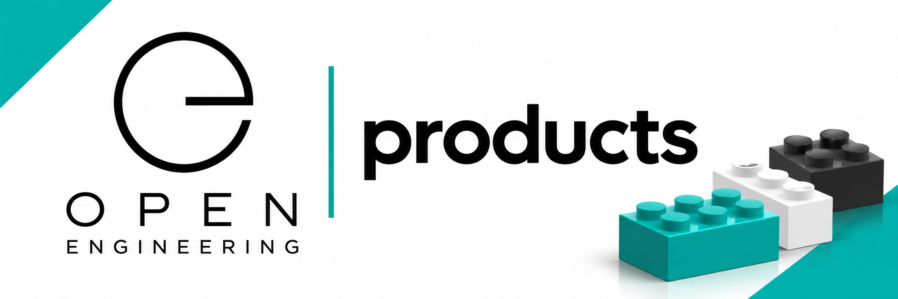
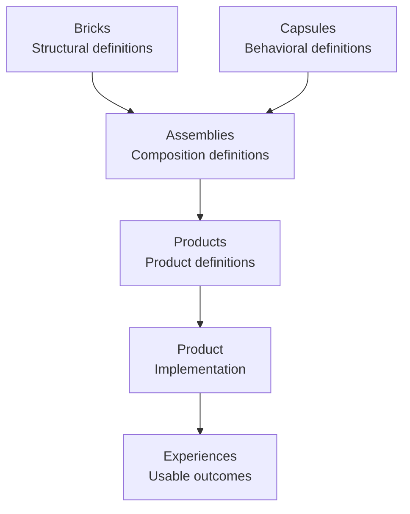
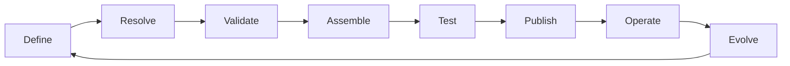

# Open Engineering Products

<p align="center">
  
</p>

<p align="center">
  <strong>Define products. Assemble capabilities. Deliver experiences.</strong>
</p>

<p align="center">
  <em>Products are assembled, not built.</em>
</p>

---

## Welcome to Open Engineering Products

**Open Engineering Products** defines what constitutes a product within the Open Engineering ecosystem.

Rather than treating a software product as a monolithic application that must be built from scratch, Open Engineering treats a product as a **declarative composition of reusable architectural bricks, behavioral capsules, and assemblies**.

A product definition describes the intended capabilities, architecture, behavior, interfaces, constraints, and lifecycle of a product independently of its implementation.

This organization owns the **definitions and contracts** governing Open Engineering products.

Actual product implementations belong to [Open Engineering Product](https://github.com/open-engineering-product).

> **Open Engineering Products defines what a product is. Open Engineering Product realizes a product definition.**

---

## 1. Philosophy: From Building to Assembling

Traditional software development often starts by building a new application, introducing new components and integrating them into a dedicated solution.

Open Engineering introduces a different approach:

**Define the product, select reusable capabilities, declare their composition, and assemble the result.**

The distinction is fundamental:

| Traditional approach | Open Engineering approach |
|---|---|
| Build applications | Assemble products |
| Develop dedicated components | Reuse architectural bricks |
| Embed behavior in applications | Compose behavioral capsules |
| Hard-code integrations | Declare relationships and contracts |
| Duplicate architectures | Reuse assembly definitions |
| Deploy monolithic solutions | Realize versioned product definitions |
| Document the finished system | Make architecture part of the product definition |

A product is therefore not primarily a collection of source files.

It is a **defined, traceable, reproducible composition** whose implementation can evolve independently of its intent.

---

## 2. The Open Engineering Composition Model

Open Engineering distinguishes four fundamental concepts:

| Concept | Responsibility | Organization |
|---|---|---|
| Brick | Defines a reusable structural or architectural building block | [Open Engineering Bricks](https://github.com/open-engineering-bricks) |
| Capsule | Encapsulates reusable behavior or capabilities | [Open Engineering Capsules](https://github.com/open-engineering-capsules) |
| Assembly | Defines how bricks and capsules are composed | [Open Engineering Assemblies](https://github.com/open-engineering-assemblies) |
| Product | Defines a coherent, usable outcome composed from assemblies | **Open Engineering Products** |

Each concept separates **definition** from **implementation**.

| Definition | Implementation |
|---|---|
| [Open Engineering Bricks](https://github.com/open-engineering-bricks) | [Open Engineering Brick](https://github.com/open-engineering-brick) |
| [Open Engineering Capsules](https://github.com/open-engineering-capsules) | [Open Engineering Capsule](https://github.com/open-engineering-capsule) |
| [Open Engineering Assemblies](https://github.com/open-engineering-assemblies) | [Open Engineering Assembly](https://github.com/open-engineering-assembly) |
| [Open Engineering Products](https://github.com/open-engineering-products) | [Open Engineering Product](https://github.com/open-engineering-product) |

### Composition hierarchy



A product definition may reference multiple assemblies and may describe multiple runtime configurations, environments, or scenarios.

An assembly does not automatically constitute a product.

A product adds **purpose, identity, requirements, supported experiences, operational expectations, and lifecycle governance** to its assemblies.

---

## 3. What Is an Open Engineering Product?

An **Open Engineering Product** is a versioned, declarative definition of an identifiable solution that delivers a coherent set of capabilities to its intended consumers.

A product definition establishes:

1. **Identity** — name, description, ownership, and version.
2. **Purpose** — the problem addressed and the value delivered.
3. **Consumers** — intended users, systems, or other products.
4. **Capabilities** — functional and behavioral responsibilities.
5. **Composition** — references to reusable assemblies.
6. **Interfaces** — exposed contracts and integration boundaries.
7. **Requirements** — functional and non-functional expectations.
8. **Architecture** — architectural constraints and decisions.
9. **Scenarios** — supported configurations and variations.
10. **Missions** — goal-oriented activities supported by the product.
11. **Validation** — acceptance criteria and assessment requirements.
12. **Lifecycle** — versioning, compatibility, releases, and evolution.

A product definition is **not**:

- An executable application.
- A deployment manifest alone.
- A repository containing arbitrary source code.
- A single architectural brick.
- A single behavioral capsule.
- An assembly without product-level intent.
- A specific runtime instance.

Those artifacts may participate in implementing or operating a product, but they do not replace its definition.

---

## 4. Product Definition Contract

Open Engineering Products proposes a machine-readable **Product Definition Contract**.

The contract establishes the minimum information needed to identify, resolve, validate, and assemble a product.

### Illustrative product definition

```yaml
apiVersion: openengineering.dev/v1alpha1
kind: Product

metadata:
  name: open-engineering-architecture
  version: 1.0.0
  description: >
    An interactive, explorable architecture
    experience assembled from reusable
    Open Engineering capabilities.

spec:
  purpose: >
    Enable people and systems to explore,
    understand, assess, and interact with
    software architecture.

  consumers:
    - software-architect
    - software-engineer
    - stakeholder
    - ai-agent

  capabilities:
    - architecture-exploration
    - architecture-visualization
    - scenario-selection
    - architectural-narration
    - architecture-assessment

  assemblies:
    - ref: open-engineering-architecture
      version: "1.x"

  interfaces:
    - name: architecture-explorer
      type: user-interface

  scenarios:
    - default
    - secure-https

  validation:
    - schema-validation
    - dependency-resolution
    - contract-validation
    - architecture-assessment

  lifecycle:
    versioning: semver
    releasePolicy: validated
```

This example is a **proposed contract**, not a claim that a production schema or resolver already exists.

The contract should eventually be validated against a published JSON Schema or equivalent machine-readable specification.

### Contract principles

- Definitions must be declarative.
- References must be explicit and resolvable.
- Dependencies must be versioned.
- Implementations must conform to their definitions.
- Validation must be repeatable.
- Definitions must remain independent of a particular runtime.
- Product identity must remain stable across compatible implementations.

---

## 5. Product Versus Assembly

A product and an assembly are closely related but serve different purposes.

**An assembly describes how capabilities fit together. A product describes why that composition exists and what it must deliver.**

| Concern | Assembly definition | Product definition |
|---|---|---|
| Primary question | How is it composed? | What does it deliver? |
| Structural composition | Primary | Referenced |
| Behavioral composition | Primary | Referenced |
| Product identity | Optional | Required |
| Consumer requirements | Supporting | Primary |
| Business or user value | Supporting | Required |
| Acceptance criteria | Component-level | Product-level |
| Versioning | Assembly version | Product version |
| Lifecycle | Composition lifecycle | Product lifecycle |
| Implementation | Open Engineering Assembly | Open Engineering Product |

Multiple products may reuse the same assembly.

Likewise, a single product may compose several assemblies.

This enables Open Engineering to support a **family of products** without duplicating their underlying architecture.

---

## 6. Example Products

The Open Engineering approach is intended to support products from different domains through the same composition model.

### Open Engineering Architecture

An interactive architectural exploration product.

Potential capabilities include:

- Architecture visualization using LikeC4 models.
- Interactive Babylon.js scenes.
- Architecture Decision Records.
- Specifications and assessments.
- Scenario selection.
- Architectural missions.
- Narration and guided exploration.

The product definition describes these capabilities and their expected contracts.

Their implementations remain independently replaceable.

### Agility Game

An interactive business simulation inspired by board-game mechanics.

Potential capabilities include:

- Game rules and progression.
- Interactive game boards.
- Players and characters.
- Business scenarios.
- Missions and challenges.
- Decisions and consequences.
- Scoring and feedback.

Agility Game can reuse architectural visualization, simulation, character, and interaction capabilities without becoming a fork of Open Engineering Architecture.

### PixStars

An interactive performance product combining human creativity, robotics, music, animation, and artificial intelligence.

Potential capabilities include:

- Performance orchestration.
- Character interaction.
- Robotics and movement.
- Speech and narration.
- Visual storytelling.
- Timeline synchronization.
- Human–AI collaboration.

PixStars demonstrates that an Open Engineering product need not be a conventional business application.

### Product diversity

These examples illustrate an important principle:

> **Products may differ radically in purpose and experience while sharing the same composition system.**

---

## 7. Product Lifecycle

Open Engineering Products defines a lifecycle independent of any particular implementation technology.



### Define

Declare the product's purpose, capabilities, contracts, dependencies, scenarios, and acceptance criteria.

### Resolve

Identify compatible versions of referenced assemblies, capsules, bricks, and external dependencies.

### Validate

Verify schema conformance, dependency compatibility, architectural constraints, and product requirements.

### Assemble

Delegate realization to Open Engineering Assembly and the appropriate implementation mechanisms.

### Test

Verify that the resulting product satisfies its definition, including functional and non-functional expectations.

### Publish

Release the validated product implementation and its associated metadata, artifacts, and provenance.

### Operate

Run, observe, and manage the realized product within its supported environments.

### Evolve

Introduce new capabilities, scenarios, versions, or compositions while preserving explicit compatibility expectations.

**Open Engineering Products governs the lifecycle contract; implementation and operational systems execute the corresponding activities.**

---

## 8. Architecture as a Product

Open Engineering Architecture is itself an example of a product defined using Open Engineering principles.

This creates an important architectural property:

**Open Engineering can describe and explain its own composition using the same definitions it applies to other products.**

Its architecture models, decisions, specifications, assessments, scenarios, missions, and narrations become reusable product capabilities.

An architecture can therefore be:

- Defined.
- Assembled.
- Explored.
- Explained.
- Assessed.
- Tested.
- Versioned.
- Reassembled.

This supports architecture as an interactive, evolving product rather than merely a collection of diagrams and documents.

---

## 9. Product Definition Artifacts

A product definition may reference the following architectural artifacts:

| Artifact | Purpose |
|---|---|
| Product manifest | Declares identity, composition, and contracts |
| Architecture model | Describes structural relationships |
| Architecture Decision Record | Records architectural choices and rationale |
| Specification | Defines expected properties and behavior |
| Assessment | Evaluates conformity and quality |
| Scenario | Describes an alternative configuration or condition |
| Mission | Defines a goal-oriented activity or workflow |
| Interface contract | Defines interactions with external consumers |
| Assembly reference | Identifies reusable compositions |
| Validation policy | Defines acceptance and conformity requirements |
| Release metadata | Identifies versions, dependencies, and provenance |

These artifacts should be independently maintainable and reusable where appropriate.

A product definition references them rather than requiring every artifact to be embedded in a single monolithic document.

---

## 10. Versioning and Compatibility

Product definitions should follow explicit versioning and compatibility policies.

Semantic Versioning is the proposed default:

- **MAJOR** — incompatible changes to the product contract.
- **MINOR** — backward-compatible capability additions.
- **PATCH** — backward-compatible corrections and refinements.

Product versions and assembly versions are independent.

A new assembly implementation does not automatically require a new product definition version.

Likewise, a product definition may evolve without requiring every underlying component to change.

Reproducible product realization requires resolved, immutable dependency references or a corresponding lock manifest.

A product release should identify:

- Product definition version.
- Resolved assembly versions.
- Referenced artifact versions.
- Validation results.
- Implementation release.
- Provenance information.

---

## 11. Governance and Architectural Integrity

Open Engineering Products follows the principle of **Rule of Existing Gravity**.

Before introducing or changing a product definition, existing architectural structures, contracts, capabilities, and dependencies should be examined.

Product definitions should favor reuse over unnecessary duplication.

### Governance principles

1. **Definition before implementation** — product intent and contracts are explicit.
2. **Composition before duplication** — existing capabilities are considered first.
3. **Contracts before coupling** — integration boundaries are defined.
4. **Traceability before release** — product dependencies and decisions are identifiable.
5. **Validation before publication** — conformity is demonstrated.
6. **Evolution without fragmentation** — compatible changes preserve reuse.

Changes to shared product contracts should be assessed for their impact on existing product definitions and implementations.

---

## 12. Relationship to the Open Engineering Ecosystem

Open Engineering Products participates in a broader ecosystem of complementary organizations.

| Organization | Responsibility |
|---|---|
| [Open Engineering](https://github.com/open-engineering) | Overall ecosystem and engineering philosophy |
| [Open Engineering Bricks](https://github.com/open-engineering-bricks) | Reusable structural definitions |
| [Open Engineering Brick](https://github.com/open-engineering-brick) | Brick implementations |
| [Open Engineering Capsules](https://github.com/open-engineering-capsules) | Reusable behavioral definitions |
| [Open Engineering Capsule](https://github.com/open-engineering-capsule) | Capsule implementations |
| [Open Engineering Assemblies](https://github.com/open-engineering-assemblies) | Composition definitions |
| [Open Engineering Assembly](https://github.com/open-engineering-assembly) | Composition realization |
| **Open Engineering Products** | **Product definitions and contracts** |
| [Open Engineering Product](https://github.com/open-engineering-product) | Product implementations |
| [Open Engineering Architecture](https://github.com/open-engineering-architecture) | Architecture product and associated capabilities |

These responsibilities establish a separation between reusable definitions, their implementations, and the products composed from them.

---

## 13. Proposed Repository Structure

A future source repository may organize product definitions and schemas as follows:

```text
open-engineering-products/
├── .github/
│   └── profile/
│       ├── README.md
│       └── hero-banner.png
├── source/
│   ├── schema/
│   │   └── product.schema.json
│   ├── definitions/
│   │   ├── open-engineering-architecture.yaml
│   │   ├── agility-game.yaml
│   │   └── pixstars.yaml
│   ├── contracts/
│   ├── policies/
│   ├── examples/
│   └── README.md
└── README.md
```

This structure is illustrative and does not imply that these repositories or files already exist.

Definitions should remain technology-neutral where possible, with implementation-specific concerns delegated to their appropriate repositories.

---

## 14. Roadmap

The following capabilities are proposed for the evolution of Open Engineering Products.

| Stage | Objective |
|---|---|
| 1. Define | Establish product ontology and definition contract |
| 2. Standardize | Publish schemas, examples, and validation rules |
| 3. Resolve | Introduce assembly and dependency resolution |
| 4. Validate | Automate product contract and architecture checks |
| 5. Assemble | Integrate with Open Engineering Assembly |
| 6. Publish | Establish versioned product definition releases |
| 7. Explore | Enable visualization and narration of product definitions |
| 8. Evolve | Support product families, variants, and compatibility governance |

The long-term goal is a declarative product ecosystem in which new solutions can be introduced primarily through **composition and configuration**, rather than duplicated implementation effort.

---

## 15. Guiding Principle

> We do not start by asking what code must be written.
>
> We start by asking what product must exist, what capabilities it requires, and how those capabilities can be assembled.

Open Engineering Products provides the definitions that make this possible.

**Define once. Compose deliberately. Assemble repeatedly.**

---

<p align="center">
  <strong>Open Engineering Products</strong>
  <br/>
  Definitions for composable software products.
  <br/>
  <em>The future of software is assembled.</em>
</p>
